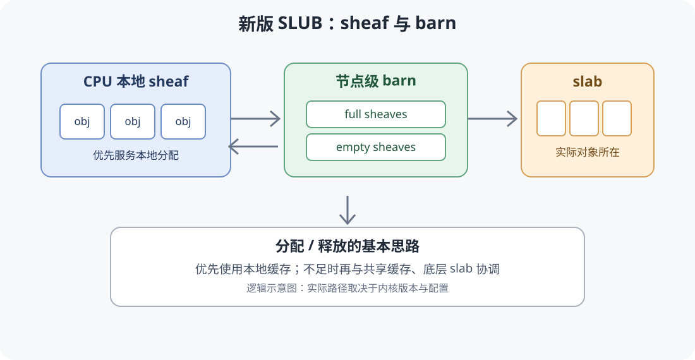
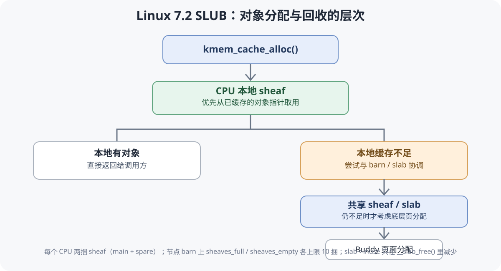
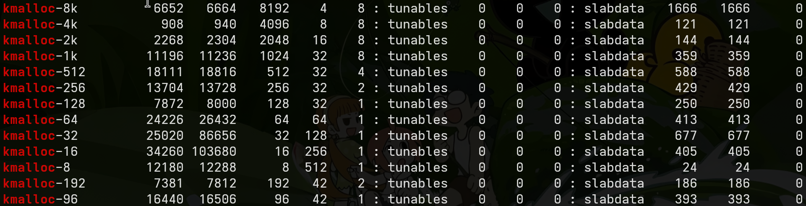
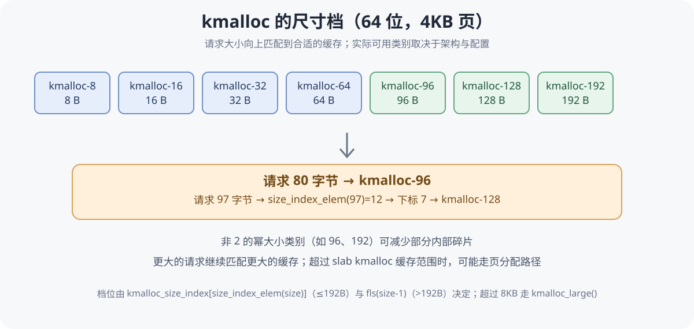

在linux中，分配内存有三种方式：栈、堆和`mmap`匿名内存。其中最常用也最复杂的是堆(heap)。为了精细管理堆内存，无论是用户态(`ptmalloc2`)还是内核态(`slub` + `buddy` 伙伴系统)都有自己的堆内存管理器。

随着kernel版本更新，slub也在不断升级重构。

### kernel 6.18

先来看看7.0之前的slub。

#### page & folio

让我们从linux的分页内存讲起。linux kernel 为了方便内存的分配与管理，会将物理内存划分为固定大小的页。在不开启大页的x86架构下，一页通常是4KB，特定优化的机器上甚至能开到2GB一页。

内核为每个物理页维护相应的页面描述符 `page`，用来记录这一页的管理元数据。

源码：[Linux v6.18 struct page](https://elixir.bootlin.com/linux/v6.18.6/C/ident/page)

为了方便理解，可以把它简化成这样：

```c
struct page {
    // 页面状态标志
    unsigned long flags;

    // 不同用途会复用这部分字段
    union {
        struct {
            // 用于把页面组织进 LRU 等链表
            struct list_head lru;

            // 页面所属的地址空间
            struct address_space *mapping;

            // 页面在地址空间中的索引
            unsigned long index;

            // 页面私有数据
            unsigned long private;
        };

        // 其他页面管理场景对应的字段
    };

    // 描述符还承载 _flags、_refcount、_mapcount
    // 以及若干按场景复用的联合体成员
};
```

`struct page` 记录的是页面的管理信息。把一个对象指针换算成物理页，内核走的是 `virt_to_page()` → PFN → `page_to_phys()` 这条链：先由虚拟地址得到页框号，再按架构的地址转换关系算出物理地址。页面描述符本身集中存放在 `vmemmap` 区域，与它所描述的页数据分开。

一次性管理一个或多个页面的抽象，叫做 `folio`，`folio` 的出现大大简化了管理多页的麻烦。


#### buddy

那么，谁来给内核分配物理内存页呢？buddy伙伴系统登场了。

Buddy通常按order分配连续的物理页。假设基础页大小为4KB，那么order为0时分配1页，order为1时分配2页，order为2时分配4页，以此类推。

```c
// 示例：申请一个 order 为 2 的页面块
// 4KB * 2^2 = 16KB（假设基础页大小为4KB）
struct page *page = alloc_pages(GFP_KERNEL, 2);
```

#### slab

但是呢，4KB的内存有些过于大了。对于那些一次只申请几十字节的请求来说，每次都分配一个page，岂不是很不方便？

这时候，slab结构就派上用场了。一个slab包含一段连续内存，并把这块内存划分为若干大小相等的小对象，分发给需要的内核代码使用。注意这里的连续内存可能为一页或多页。


在SLUB中，有几个概念需要区分：

- `kmem_cache`：管理一类固定大小对象的缓存。
- `slab`：承载对象的页面内存。
- `object`：真正被分配给调用方使用的小对象。

如果一个页面被用于slab管理，内核就通过 `struct slab`
这个视图访问它的描述符。`struct slab` 与 `struct page`
共用同一块描述符存储（`struct slab` 用联合体复用 `struct page`
的字段），两者是同一份描述符针对不同用途的两种视图。被 SLUB
接管的页在页标志里带 `PG_slab`，`page_slab()` 据此把描述符当作
`struct slab` 使用。

源码：[Linux v6.18
`mm_types.h`](https://elixir.bootlin.com/linux/v6.18.6/source/mm/slab.h#L52)

#### freelist

知道了slab和object，接下来还有一个问题：当一个slab中有多个对象时，slub怎么知道哪些对象还可以使用？

答案是freelist，即空闲对象链表。

传统SLUB通常会利用空闲对象自身的空间保存链表所需的信息。分配对象时，从freelist中取出一个对象；释放对象时，则将对象重新放回相应的空闲管理路径。


空闲指针写在对象内部的哪个位置由 `s->offset` 决定：`set_freepointer()`
把下一个空闲对象的地址写到 `object + s->offset`，`get_freepointer()`
从这里读回来。打开 `CONFIG_SLAB_FREELIST_HARDENED` 时，写入的值要经
`freelist_ptr_encode()` 与 `s->random`、该字段自身的地址一起编码，读回时由
`freelist_ptr_decode()` 还原；打开 `CONFIG_SLAB_FREELIST_RANDOM` 时，新建
slab 的 freelist 顺序被打乱。当 `s->offset >= s->inuse` 时（`freeptr_outside_object()`
为真），空闲指针槽落在对象之外。

#### kmem_cache_cpu

在Linux 6.18的传统SLUB实现中，`kmem_cache_cpu`
是CPU本地快速分配路径的重要结构。

源码：[Linux v6.18
`mm/slub.c`](https://github.com/torvalds/linux/blob/v6.18/mm/slub.c)

它维护当前CPU快速分配所需的状态，例如当前使用的slab和freelist。这样，分配器在常见情况下就不必每次都访问共享数据结构。

```c
// 从指定缓存申请一个对象
void *obj = kmem_cache_alloc(cache, GFP_KERNEL);
```

可以简单理解为：如果当前CPU的freelist中有空闲对象，就可以快速取出；如果没有，就需要进入较慢的分配路径，寻找其他可用slab，必要时再向Buddy申请页面。

本地缓存提升了分配效率，但也增加了不同CPU之间协调和缓存管理的复杂度。

### kernel 7.2

到了Linux kernel 7.2，SLUB的对象缓存机制有了重要变化：新的实现围绕
`sheaf` 组织一批对象指针，并使用 `barn` 等结构协调共享缓存。

源码：[Linux v7.2
`mm/slub.c`](https://github.com/torvalds/linux/blob/v7.2/mm/slub.c)

新版把批量指针缓存放到了分配路径的前端：对象在 CPU 本地 sheaf、节点 barn
与底层 slab 之间流转，`kmem_cache_cpu` 的职责由 per-CPU sheaf 结构接替。

#### sheaf

sheaf可以理解成"一捆对象"。它缓存的是对象指针；对象本身仍然位于slab管理的内存中，sheaf只记录指向它们的地址。



在源码中，`struct slab_sheaf`
用于描述sheaf：

```c
struct slab_sheaf {
    union {
        struct rcu_head rcu_head;   // kfree_rcu 路径上排队用
        struct barn_list barn_list; // 挂在 barn 链表上时
        struct llnode llnode;       // 批量处理时的链节点
        struct {
            unsigned int capacity;
            bool pfmemalloc;
        };
    };
    struct kmem_cache *cache;       // 这捆指针所属的缓存
    unsigned int size;              // 已装入的指针个数
    int node;                       // 所属 NUMA 节点
    void *objects[];                // 对象指针数组
};
```

头部占32字节，后面紧跟`objects[]`，`capacity`记录这捆能装多少指针，`s->sheaf_capacity`给出这个上限。

例如，一个sheaf可以容纳一批对象指针。后续申请对象时，分配器可以优先从本地sheaf中取用，减少频繁进入共享路径的开销。

传统SLUB的批量处理集中在`kmem_cache_alloc_bulk()`与`kmem_cache_free_bulk()`这类接口上；新版把这套批量指针缓存提到了每次分配与释放都会经过的位置，sheaf就是它的载体。

#### barn

如果每个CPU都有自己的sheaf，那么本地缓存不足时应该从哪里补充？如果本地缓存中有一批暂时用不到的对象，又该放在哪里？

新版SLUB使用 `barn` 作为共享sheaf的协调机制之一。相关实现中可以看到
`struct node_barn`，以及管理full和empty sheaf的链表。

简单来说：

- full sheaf：保存了一批对象指针，可以提供对象。
- empty sheaf：当前没有可用对象指针，可以重新填充。
- barn：在共享范围内协调这些sheaf。

#### 分配流程

分配入口是 `kmem_cache_alloc()` → `slab_alloc_node()`：先过 memcg 记账、kfence 与调试 hook，然后交给 `alloc_from_pcs()` 从 per-CPU sheaf 取值，取不到才进 `___slab_alloc()` 慢路径。

```c
if (unlikely(pcs->main->size == 0)) {
	pcs = __pcs_replace_empty_main(s, pcs, gfp, alloc_flags);
	if (unlikely(!pcs))
		return NULL;
}

object = pcs->main->objects[pcs->main->size - 1];
pcs->main->size--;
```

`__pcs_replace_empty_main()` 依次试两种做法：spare 里有指针就与 main 对调；没有就从 barn 的 `sheaves_full` 换一捆满的回来。两处都落空时返回 NULL，由 `___slab_alloc()` 补货。

补货由 `refill_objects()` 完成：从节点 partial 链表上摘 slab，把页上的空闲指针搬进 sheaf 的 `objects[]`；partial 链表空了就 `new_slab()` 向伙伴系统要页。

`kmem_cache_alloc_bulk()` 对应 `alloc_from_pcs_bulk()`，一次从 sheaf 里搬出多个指针。分配侧与释放侧在同一个下标上对接：释放从 `objects[size]` 往里压，分配从 `objects[size - 1]` 往外弹，两端都不需要移动其它指针。

#### 释放流程

`kfree()` 与 `kmem_cache_free()` 都收敛到 `slab_free()`：先过 memcg 记账与调试 hook，再把对象交给 `free_to_pcs()` 压入 per-CPU sheaf；压不进去才走 `__slab_free()`。

```c
if (!local_trylock(&s->cpu_sheaves->lock))
	return false;

pcs = this_cpu_ptr(s->cpu_sheaves);

if (unlikely(pcs->main->size == s->sheaf_capacity)) {
	pcs = __pcs_replace_full_main(s, pcs, allow_spin);
	if (unlikely(!pcs))
		return false;
}

pcs->main->objects[pcs->main->size++] = object;
local_unlock(&s->cpu_sheaves->lock);
```

写指针指向下标 `size`，从尾部追加。main sheaf 因此是一个 LIFO 栈：同一个 CPU 上最后释放的对象，最先被再次分配出去。

main 写满后由 `__pcs_replace_full_main()` 换一捆：

1. spare 有空位：`swap(pcs->main, pcs->spare)`。per-CPU 结构就是 main 与 spare 两捆，spare 专门吸收这种情况。
2. spare 也满了：`barn_replace_full_sheaf()` 把满的 main 挂进本节点 barn 的 `sheaves_full`，从 `sheaves_empty` 取一捆空的回来。barn 的满 sheaf 已经到上限时，直接把这捆里的指针倒回 slab，sheaf 本身留着给 main 用。
3. barn 里没有空 sheaf：`alloc_empty_sheaf()` 现场 `kmalloc` 一捆裸指针数组，`sheaf_try_flush_main()` 把 main 里的对象分批倒回 slab。

倒回 slab 的做法是：每批最多 32 个指针先拷到栈上，放锁之后再调 `__kmem_cache_free_bulk()`。



#### 把对象还给 slab

`__kmem_cache_free_bulk()` 先把属于同一个 slab 的对象串成一段 freelist，再交给 `__slab_free()`：

```c
old.freelist = slab->freelist;
old.counters = slab->counters;

was_full = (old.freelist == NULL);

set_freepointer(s, tail, old.freelist);
new.freelist = head;
new.counters = old.counters;
new.inuse -= cnt;

slab_update_freelist(s, slab, &old, &new, "__slab_free");
```

`slab_update_freelist()` 用一次 `cmpxchg_double` 同时替换 freelist 与 counters，失败就重新取快照再试。之后只有两种情况需要动节点链表：

- `was_full` 为真：slab 从满变成有空闲，把它挂到本节点 partial 链表的尾部。
- `new.inuse` 归零：slab 里没有在用对象了。partial 链表的长度达到 `min_partial` 时，把它摘下来交给 `discard_slab()` 还给伙伴系统；长度不够时，这个空 slab 继续留在 partial 链表上当备货。

`min_partial` 按对象大小算出，落在 5 到 10 之间（`ilog2(s->size) / 2` 再夹到这段区间），可以在 `/sys/kernel/slab/<cache>/min_partial` 读写。

整条释放链路上，`slab->inuse` 只在 `__slab_free()` 里减少。对象指针停在 sheaf 里的这段时间，它所属的 slab 仍然按已分配记账，页面不会被回收。回收因此分成两层：对象先进入 sheaf，页面要等 sheaf 里的指针倒回 slab、`inuse` 归零、并且 partial 链表已经够长，才回到伙伴系统。

#### 哪些对象绕过 sheaf

`can_free_to_pcs()` 看两件事：slab 所在节点是不是当前 CPU 的本地节点（`numa_mem_id()`），以及 slab 有没有 `pfmemalloc` 标记。远端节点的对象进入本地 sheaf 会把远端页面长期钉在缓存里，`pfmemalloc` slab 上的对象另有用途，这两类都直接走 `__slab_free()`。

`sheaf_capacity` 为 0 的缓存整条 sheaf 通道关闭：`CONFIG_SLUB_TINY`、带 `SLAB_DEBUG_FLAGS`（`slub_debug` 打开）、带 `SLAB_NO_SHEAVES`、带 `SLAB_NOLEAKTRACE`（kmemleak 自己的对象缓存），以及启动阶段的 bootstrap 缓存。`local_trylock()` 失败时同样退回 slab 路径。

#### 批量释放与 kfree_rcu

`kmem_cache_free_bulk()` 走 `free_to_pcs_bulk()`：先按 `can_free_to_pcs()` 分出本地与远端两堆，本地对象分批压入 sheaf，远端对象留到最后统一处理。

`kfree_rcu()` 用单独一捆 sheaf 暂存对象：攒满后挂上 `call_rcu()`，宽限期结束再把整捆交给 barn 复用；barn 满了就把里面的指针倒回各自 slab。

#### sheaf 的容量

`sheaf_capacity` 在缓存创建时算出来，先按对象大小取初值：

| `s->size` | 初值 |
| --------- | ---- |
| ≥ 4KB     | 4    |
| ≥ 1KB     | 12   |
| ≥ 256B    | 26   |
| 其它      | 60   |

再把「头部 32 字节 + capacity 个指针」的总字节数向上取到最近的 kmalloc 档位，反推最终容量。`kmalloc-96` 这一档：初值 60，`32 + 60 * 8 = 512` 正好是一个 kmalloc 档位，容量定在 60。对象大小 256 的缓存：初值 26，`32 + 26 * 8 = 240` 向上取到 256，容量变成 `(256 - 32) / 8 = 28`。

sheaf 自身也是一次普通 `kmalloc`，空 sheaf 用 `kfree` 归还。容量可以在 `/sys/kernel/slab/<cache>/sheaf_capacity` 读到。

#### barn 的内部结构

barn 是「每个缓存 + 每个 NUMA 节点」一个的共享池：

```c
struct node_barn {
	spinlock_t lock;
	struct list_head sheaves_full;
	struct list_head sheaves_empty;
	unsigned int nr_full;
	unsigned int nr_empty;
};
```

`sheaves_full` 上挂着装满对象指针的 sheaf，供给耗尽的 CPU；`sheaves_empty` 上挂着空 sheaf，供给写满的 CPU。两个方向各有一个交换接口：`barn_replace_empty_sheaf()` 用空的换满的，`barn_replace_full_sheaf()` 用满的换空的。`nr_full` 与 `nr_empty` 各自的上限是 10（`MAX_FULL_SHEAVES` / `MAX_EMPTY_SHEAVES`），超出的满 sheaf 就地倒回 slab，超出的空 sheaf 直接 `kfree`。

barn 属于节点，一个节点上的所有 CPU 共用这一批 sheaf。CPU 下线、`kmem_cache_shrink()`、缓存销毁都会调用 `pcs_flush_all()`，把每个 per-CPU 的 main 与 spare 倒回 slab。

### kmalloc 的尺寸档

读取 /proc/slabinfo 的部分字段



`kmalloc(size, flags)` 只接受字节数，具体缓存由内核查表决定：

```c
static inline struct kmem_cache *
kmalloc_slab(size_t size, kmem_buckets *b, gfp_t flags, kmalloc_token_t token,
	     unsigned int alloc_flags)
{
	unsigned int index;
	enum kmalloc_cache_type type = kmalloc_type(flags, token);
	...
	if (!b)
		b = &kmalloc_caches[type];
	if (size <= 192)
		index = kmalloc_size_index[size_index_elem(size)];
	else
		index = fls(size - 1);

	return (*b)[index];
}
```

`size_index_elem(bytes)` 是 `(bytes - 1) / 8`，8~192 字节这一段按 8 字节步进查 `kmalloc_size_index[24]`；超过 192 字节直接用 `fls(size - 1)` 得到 2 的幂档位。

64 位、4KB 页下的档位是 8、16、32、64、96、128、192、256、512、1K、2K、4K、8K。96 与 192 夹在 2 的幂之间，用来减少内部碎片。请求 80 字节 → `kmalloc_size_index[9]` = 1 → `kmalloc-96`；请求 97 字节 → `kmalloc_size_index[12]` = 7 → `kmalloc-128`。

`KMALLOC_MAX_CACHE_SIZE` 等于 `PAGE_SIZE * 2`（4KB 页下是 8KB）。更大的请求由 `kmalloc_large()` 直接向伙伴系统要连续页，`kfree()` 用 `free_large_kmalloc()` 归还。

同一档位还会按 gfp 标志拆成几份缓存：

- `__GFP_RECLAIMABLE` → `kmalloc-rcl-96`
- `__GFP_ACCOUNT`（`CONFIG_MEMCG`）→ `kmalloc-cg-96`
- `__GFP_DMA`（`CONFIG_ZONE_DMA`）→ `dma-kmalloc-96`
- `CONFIG_SLAB_OBJ_EXT` 下另有一份 `kmalloc-no-objext-96`，`CONFIG_KMALLOC_PARTITION_*` 下还有 15 份 `kmalloc-part-XX-96`

`kmalloc_type()` 的选择优先级是 `__GFP_DMA` > `__GFP_RECLAIMABLE` > `__GFP_ACCOUNT`。



### 专用缓存与缓存合并

`kmem_cache_create()` 先调用 `__kmem_cache_alias()` → `find_mergeable()`，尺寸、对齐、标志都对得上的已有缓存会被直接复用：`size <= s->size` 且 `s->size - size < sizeof(void *)`，`SLAB_MERGE_SAME` 那几位一致，`(s->size & ~(align - 1)) == s->size`。带调试标志、`SLAB_TYPESAFE_BY_RCU`、`SLAB_NOLEAKTRACE`、构造函数或 usercopy 区域的缓存不参与合并。

合并成功后，本次名字变成 sysfs 里的别名符号链接，`s->object_size` 与 `s->inuse` 取两者较大值，`kzalloc` 需要清零的字节数由此覆盖到调用者请求的长度。启动参数 `slab_nomerge` 或关闭 `CONFIG_SLAB_MERGE_DEFAULT` 会让全部缓存退出合并。

### 观察运行时状态

- `/proc/slabinfo`：每行 `name active_objs num_objs objsize objperslab pagesperslab`。`objsize` 是 `s->size`（含元数据），`objperslab` 是一个 slab 里的对象数。
- `/sys/kernel/slab/<cache>/`：常用属性 `object_size`、`slab_size`、`objs_per_slab`、`order`、`sheaf_capacity`、`min_partial`、`aliases`。
- `CONFIG_SLUB_STATS`：每档缓存下多出各条路径的命中计数，`alloc_fastpath`、`free_slowpath`、`barn_get`、`sheaf_flush` 这类名字直接对应上面走过的分支。

### 总结

对象在 SLUB 里的三层结构：

- `slab`：由伙伴系统给出的一到多页连续内存，切成等大的对象。
- `sheaf`：一捆对象指针，per-CPU 两捆（`main` 与 `spare`），容量按对象大小取 4 / 12 / 26 / 60 后对齐到 kmalloc 档位。
- `barn`：每个缓存、每个 NUMA 节点一个，`sheaves_full` 与 `sheaves_empty` 各上限 10 捆，在节点的 CPU 之间搬 sheaf。

分配走 `alloc_from_pcs()`：main sheaf 从尾部弹出一个指针，main 空了就与 spare 对调或从 barn 换满的，再不行就用 `refill_objects()` 从 partial 链表、最后从伙伴系统补货。

释放走 `free_to_pcs()`：main sheaf 从尾部压入一个指针，main 写满就与 spare 对调或从 barn 换空的，barn 到上限就把整捆倒回 slab。

`slab->inuse` 只在 `__slab_free()` 里变化。对象指针停留在 sheaf 中时页面不会被回收；页面要等指针倒回 slab、`inuse` 归零、partial 链表又已经够长，才由 `discard_slab()` 还给伙伴系统。

通用 `kmalloc` 的档位由 `kmalloc_size_index` 与 `fls(size - 1)` 决定，超过 `PAGE_SIZE * 2` 的请求交给伙伴系统；专用缓存在 `kmem_cache_create()` 时按尺寸、标志、对齐参与合并，合并后的别名出现在 sysfs 里。
