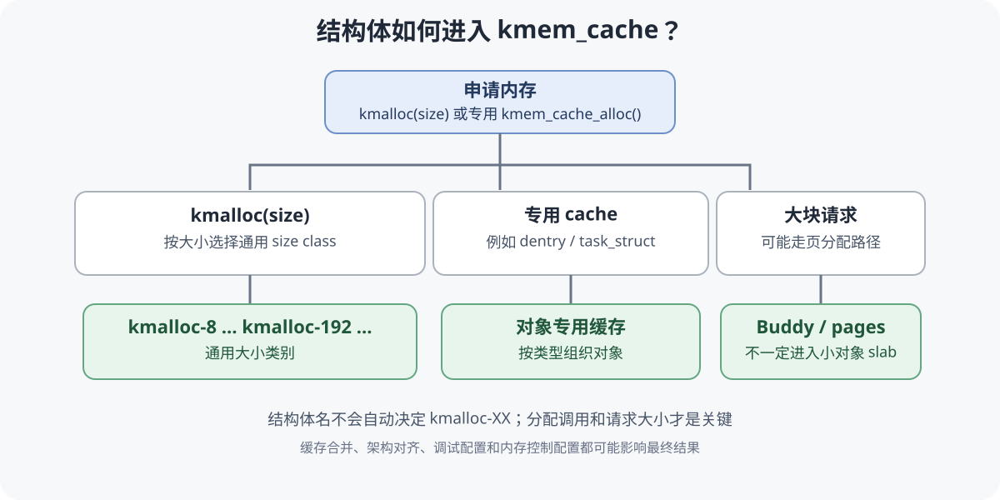
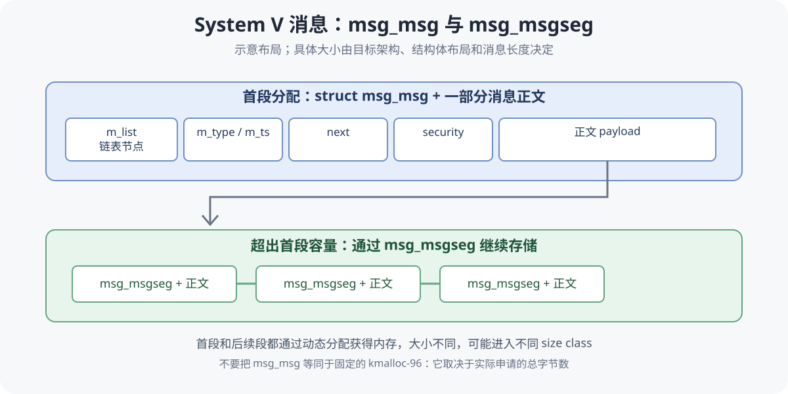

在linux中，分配内存有三种方式：栈、堆和`mmap`匿名内存。其中最常用也最复杂的是堆(heap)。为了精细管理堆内存，无论是用户态(`ptmalloc2`)还是内核态(`slub` + `buddy` 伙伴系统)都有自己的堆内存管理器。

随着kernel版本更新，slub也在不断升级重构。

### kernel 6.18

先来看看7.0之前的slub。

#### page & folio

让我们从linux的分页内存讲起。linux kernel 为了方便内存的分配与管理，会将物理内存划分为固定大小的页。在不开启大页的x86架构下，一页通常是4KB，特定优化的机器上甚至能开到2GB一页。

内核为每个物理页维护相应的页面描述符 `page`，用来记录这一页的管理元数据。

源码：[Linux v6.18 struct page](https://github.com/torvalds/linux/blob/v6.18/include/linux/mm_types.h)

为了方便理解，可以把它简化成这样：

```c
struct page {
    // 页面状态标志
    unsigned long flags;

    // 不同用途会复用这部分字段
    union {
        struct {
            // 用于把页面组织进 LRU 等链表
            struct list_head lru;

            // 页面所属的地址空间
            struct address_space *mapping;

            // 页面在地址空间中的索引
            unsigned long index;

            // 页面私有数据
            unsigned long private;
        };

        // 其他页面管理场景对应的字段
    };

    // 实际源码还包含其他联合体、引用计数、
    // 映射计数等字段，具体布局以 6.18 源码为准
};
```

也就是说，我们不能简单地通过读取 `struct page` 就直接得到物理地址。`struct page` 记录的是页面的管理信息；内核还需要结合 PFN（页框号）以及相应的地址转换关系，才能定位对应的物理页。页面描述符通常也不存放在它所描述的那一页数据里面。

一次性管理一个或多个页面的抽象，叫做 `folio`，`folio` 的出现大大简化了管理多页的麻烦。


#### buddy

那么，谁来给内核分配物理内存页呢？buddy伙伴系统登场了。

Buddy通常按order分配连续的物理页。假设基础页大小为4KB，那么order为0时分配1页，order为1时分配2页，order为2时分配4页，以此类推。

```c
// 示例：申请一个 order 为 2 的页面块
// 4KB * 2^2 = 16KB（假设基础页大小为4KB）
struct page *page = alloc_pages(GFP_KERNEL, 2);
```

#### slab

但是呢，4KB的内存有些过于大了。对于那些一次只申请几十字节的请求来说，每次都分配一个page，岂不是很不方便？

这时候，slab结构就派上用场了。一个slab包含一段连续内存，并把这块内存划分为若干大小相等的小对象，分发给需要的内核代码使用。注意这里的连续内存可能为一页或多页。


在SLUB中，有几个概念需要区分：

- `kmem_cache`：管理一类固定大小对象的缓存。
- `slab`：承载对象的页面内存。
- `object`：真正被分配给调用方使用的小对象。

如果一个页面被用于slab管理，那么内核会通过 `struct slab`
的视图访问相应的描述符信息。`struct slab` 与 `struct page`
共享底层描述符的存储空间，是针对不同用途的两种视图；并不是把一份
`struct page` 搬走，再额外创建一份
`struct slab`。也不是每个page都会成为slab页。

源码：[Linux v6.18
`mm_types.h`](https://github.com/torvalds/linux/blob/v6.18/include/linux/mm_types.h)

#### freelist

知道了slab和object，接下来还有一个问题：当一个slab中有多个对象时，slub怎么知道哪些对象还可以使用？

答案是freelist，即空闲对象链表。

传统SLUB通常会利用空闲对象自身的空间保存链表所需的信息。分配对象时，从freelist中取出一个对象；释放对象时，则将对象重新放回相应的空闲管理路径。


实际实现会受到内核版本、调试选项和freelist
hardening等安全机制影响，因此不能简单地认为所有空闲对象里都一定存在一个明文的普通指针。

#### kmem_cache_cpu

在Linux 6.18的传统SLUB实现中，`kmem_cache_cpu`
是CPU本地快速分配路径的重要结构。

源码：[Linux v6.18
`mm/slub.c`](https://github.com/torvalds/linux/blob/v6.18/mm/slub.c)

它维护当前CPU快速分配所需的状态，例如当前使用的slab和freelist。这样，分配器在常见情况下就不必每次都访问共享数据结构。

```c
// 示意：从指定的缓存中申请一个对象
void *obj = kmem_cache_alloc(cache, GFP_KERNEL);
```

可以简单理解为：如果当前CPU的freelist中有空闲对象，就可以快速取出；如果没有，就需要进入较慢的分配路径，寻找其他可用slab，必要时再向Buddy申请页面。

本地缓存提升了分配效率，但也增加了不同CPU之间协调和缓存管理的复杂度。

### kernel 7.2

到了Linux kernel 7.2，SLUB的对象缓存机制有了重要变化：新的实现围绕
`sheaf` 组织一批对象指针，并使用 `barn` 等结构协调共享缓存。

源码：[Linux v7.2
`mm/slub.c`](https://github.com/torvalds/linux/blob/v7.2/mm/slub.c)

这里的重点不是简单地把一个结构体换成另一个结构体，而是对象在CPU本地缓存、节点共享缓存以及底层slab之间的流转方式发生了变化。

#### sheaf

sheaf可以理解成"一捆对象"。它缓存的是对象指针，而不是把对象的内容复制到sheaf内部。对象本身仍然位于slab管理的内存中。


在源码中，`struct slab_sheaf`
用于描述sheaf。它包含缓存关联信息、当前对象数量以及对象指针数组等内容。下面只保留关键概念，字段布局请以v7.2源码为准：

```c
// 示意代码，不是内核源码的完整定义
struct slab_sheaf {
    struct kmem_cache *cache; // 对应的对象缓存
    unsigned int size;        // 当前保存的对象数量
    void *objects[];          // 对象指针数组
};
```

例如，一个sheaf可以容纳一批对象指针。后续申请对象时，分配器可以优先从本地sheaf中取用，减少频繁进入共享路径的开销。

这并不意味着传统SLUB完全没有批量处理能力，而是新版实现把批量对象缓存作为组织分配路径的重要方式。

#### barn

如果每个CPU都有自己的sheaf，那么本地缓存不足时应该从哪里补充？如果本地缓存中有一批暂时用不到的对象，又该放在哪里？

新版SLUB使用 `barn` 作为共享sheaf的协调机制之一。相关实现中可以看到
`struct node_barn`，以及管理full和empty sheaf的链表。

简单来说：

- full sheaf：保存了一批对象指针，可以提供对象。
- empty sheaf：当前没有可用对象指针，可以重新填充。
- barn：在共享范围内协调这些sheaf。

这里的full和empty描述的是sheaf中对象指针的状态，不是slab的状态。

#### 分配流程

假设内核调用：

```c
void *obj = kmem_cache_alloc(cache, GFP_KERNEL);
```

新版设计下，可以先检查本地sheaf。如果有可用对象，就直接取出；如果本地缓存不足，就尝试获取或补充sheaf；再不足时，才进入底层slab分配路径，必要时向Buddy申请物理页。


这是一种逻辑上的概括，不代表每次分配都严格经过全部步骤。实际路径还会受到分配标志、缓存配置、调试选项和内存状态等因素影响。

#### 释放流程

释放对象时，`kfree()` 或 `kmem_cache_free()`
会把对象交还给对应的分配器。对象可能先进入本地缓存，也可能走其他回收路径，具体取决于缓存状态和内核实现。

需要注意的是，释放一个对象并不意味着它所在的物理页会立即归还Buddy。一个slab中可能仍有其他正在使用的对象，只有满足相应回收条件时，底层页面才可能被释放。

从PWN的角度看，需要区分三个状态：

1. 对象是否已经释放。
2. 对象所在的slab是否仍然存在。
3. 底层物理页是否已经归还Buddy。

这三个状态不能混为一谈。

### 从PWN的角度看

传统SLUB会利用空闲对象空间维护freelist，因此在分析UAF、越界写等漏洞时，需要考虑对象释放之后是否会被分配器重新利用，以及空闲对象中的管理数据是否可能受到影响。

sheaf的引入，则意味着对象指针可以先被集中缓存，不一定在每次分配和释放时都立即回到底层slab的空闲对象管理路径。因此，研究新版内核时，还需要关注本地sheaf何时填充、耗尽、归还，以及barn如何协调共享缓存。

但不能简单地得出"sheaf让漏洞更容易利用"或者"sheaf让旧利用方式全部失效"的结论。具体影响必须结合目标内核版本、配置、对象缓存和真实分配路径进行分析。

### kmalloc-XX：这些缓存到底是什么？

前面讲了 `kmem_cache`，这里再具体看看经常在内核调试和PWN中遇到的
`kmalloc-96`、`kmalloc-128` 等缓存。

`kmalloc(size, flags)`
的调用者通常只指定需要多少字节，并不需要自己挑选缓存。内核会根据请求大小，选择合适的通用
`kmalloc` size class。

例如，在常见的64位配置下，可能会看到
`kmalloc-8`、`kmalloc-16`、`kmalloc-32`、`kmalloc-64`、`kmalloc-96`、`kmalloc-128`、`kmalloc-192`、`kmalloc-256`
等缓存。并不是所有类别在所有架构、配置和内核版本中都一定存在。


假设某个调用请求80字节，分配器会选择能够容纳这个请求的缓存，常见情况下就是
`kmalloc-96`。如果请求变成97字节，就不能继续放入96字节的对象，需要选择更大的类别，例如
`kmalloc-128`。

这就是为什么 `kmalloc-96`
这样的缓存很重要：它不是专门给某个结构体使用的，而是为一批大小落在这个范围内的动态分配请求提供对象。

源码可以重点看：

- [`include/linux/slab.h`](https://github.com/torvalds/linux/blob/v7.2/include/linux/slab.h)：`kmalloc()`
  相关定义和大小索引逻辑。
- [`mm/slab_common.c`](https://github.com/torvalds/linux/blob/v7.2/mm/slab_common.c)：通用
  kmalloc cache 的创建与初始化。
- [`mm/slub.c`](https://github.com/torvalds/linux/blob/v7.2/mm/slub.c)：SLUB
  的具体分配和释放实现。

#### `kmalloc-96` 是不是一个专用结构体缓存？

不是。名字里的 `96`表示这个缓存中对象的大小类别，不表示这个缓存专门保存某个名为96的结构体。

很多不同的内核调用都可能申请96字节以内的内存，只要它们走的是通用
`kmalloc()` 路径，最终就可能落到相同的 size class。反过来，同一个结构体也可能因申请大小不同而落入不同的缓存，或者因为它使用了专用
`kmem_cache` 而根本不走通用 `kmalloc-XX` 缓存。

这里还有一个细节：内核可能合并大小和属性兼容的专用缓存；编译配置、架构对齐、内存控制组以及调试选项也可能影响最终结果。所以分析具体机器时，不能只凭结构体名称猜缓存。

### 每个 kmem_cache 都分配哪些结构？

这个问题在内核堆利用中很常见，但需要先纠正一个容易产生的误解：**并不存在一张对所有内核都固定的"每个kmalloc-XX 对应哪些结构体"的表。**

原因是两类缓存需要分开看：

1. **通用 kmalloc 缓存**：例如
   `kmalloc-96`。它按申请大小接收不同类型的对象。
2. **专用对象缓存**：例如 `dentry`、`task_struct`
   等类型可能使用专门创建的
   `kmem_cache`，对象的分配路径由具体子系统决定。



下面列几个研究内核时常见的例子。

  -------------------------------------------------------------------------------------------------------------------------------------------

  对象或类型              常见分配方式                                         需要注意的地方

  ----------------------- ---------------------------------------------------- --------------------------------------------------------------

  `msg_msg`               `kmalloc(sizeof(*msg) + alen, GFP_KERNEL_ACCOUNT)`   申请大小包含结构体头部和一部分消息正文，因此会随消息长度变化
                          一类的动态大小申请                                   

  `msg_msgseg`            `kmalloc(sizeof(*seg) + alen, GFP_KERNEL_ACCOUNT)`   用于较长消息的后续分段，段大小也会影响最终分配路径
                          一类的动态大小申请                                   

  `msg_queue`             新建消息队列时通过按对象大小分配的接口申请           不能因为它属于消息队列子系统，就认为它与 `msg_msg`
                                                                               一定来自同一个缓存

  `task_struct`           通常由任务结构体对应的专用缓存管理                   不应直接归入某个通用 `kmalloc-XX` 类别

  `dentry`                目录项缓存                                           是专用缓存的典型例子

`inode`                 inode 相关缓存，具体还与文件系统有关                 不同 inode 类型可能走不同缓存或分配路径
-------------------------------------------------------------------------------------------------------------------------------------------

表中的分配方式用于说明机制；如果要精确确定某个版本的对象落在哪个缓存，仍然要跟进该版本的实际调用链、编译配置和结构体大小。

### 以 msg_msg 为例

`msg_msg` 是 System V
消息队列中的消息头。它很适合用来理解为什么不能把"结构体类型"和"kmalloc-XX"简单地一一对应。

定义可以在
[`include/linux/msg.h`](https://github.com/torvalds/linux/blob/v7.2/include/linux/msg.h)
中找到。简化后，它大致包含：

```c
struct msg_msg {
    struct list_head m_list;
    long m_type;
    size_t m_ts;          // 消息正文长度
    struct msg_msgseg *next;
    void *security;

    // 结构体后面紧接着一部分消息正文
};
```

这里的关键是：消息正文并不是一个独立的固定大小数组，而是紧跟在结构体后面。创建消息时，内核会根据消息长度计算本次需要申请的字节数。



因此，实际申请大小可以理解为：

```c
// 示意：首段申请大小由结构体头部和正文长度共同决定
size_t alen = min(len, DATALEN_MSG);
msg = kmalloc(sizeof(*msg) + alen, GFP_KERNEL_ACCOUNT);
```

如果目标架构下 `sizeof(struct msg_msg)`
为48字节，并且首段正文长度在1到48字节之间，那么申请总大小就在49到96字节之间。在常见的、启用了96字节
size class 的配置中，这类申请就可能进入 `kmalloc-96`。

但这不是说"`msg_msg` 就属于
`kmalloc-96`"。消息更长时，首段大小会变化，后续还可能分配一个或多个
`msg_msgseg`；不同分配的请求大小可能进入不同类别，甚至走不同的底层分配路径。

此外，`sizeof(struct msg_msg)`、`DATALEN_MSG`
和具体缓存类别都应以目标内核的实际源码与架构为准，不要把某个 x86-64
配置下的数值直接套到所有机器上。

### 如何确认某个对象实际来自哪个缓存？

对于 PWN 分析，最好把"根据大小推测"与"在目标环境中确认"分开。

第一步，先找到对象的分配调用。比如搜索 `kmalloc(`、`kmem_cache_alloc(`
或者对应的封装宏，确认传入的是固定大小还是动态计算的大小。

第二步，计算实际申请大小。对于 `msg_msg`，不能只计算
`sizeof(struct msg_msg)`，还要把本次分配的正文长度算进去。

第三步，确认目标内核的 size class。可以查看对应版本的
`kmalloc_size_index`、`kmalloc_info` 和 `kmalloc_slab()`
相关逻辑。不要只根据网上常见的缓存列表下结论。

第四步，在测试环境中查看实际 slab 状态：

```bash
# 查看当前系统统计的 slab 缓存
cat /proc/slabinfo

# 查看 kmalloc-96 的详细属性（如果该缓存存在）
ls /sys/kernel/slab/kmalloc-96/

# 查看可用的缓存名称
ls /sys/kernel/slab/
```

`/proc/slabinfo` 和 sysfs
适合确认运行中系统的缓存名称和统计信息，但它们通常不会直接告诉你"这个缓存里的每个对象都是什么
C
类型"。想把对象类型和缓存对应起来，仍然需要结合源码、分配调用点、调试信息或分配跟踪。

如果启用了相应的 tracepoint，也可以观察
`kmalloc`、`kfree`、`kmem_cache_alloc`
等事件，进一步关联分配调用点和请求大小。可参考 [内核 kmem tracepoint
文档](https://docs.kernel.org/trace/events-kmem.html)。

### Linux 7.2 的 sheaf：比结构体更重要的是数据流

前面已经介绍了 `sheaf` 和 `barn`
的基本概念。这里再从数据流的角度把它们串起来。


新版设计中，本地 sheaf
用于保存一批可供分配的对象指针；当本地缓存无法满足需求时，分配器可以与共享
sheaf 机制协调。如果底层 slab
中也没有足够对象，才可能继续申请新的物理页。

因此，阅读源码时不能只看 `struct slab_sheaf`
的字段，还应该沿着这些方向追踪：

- sheaf 何时被创建、填充和消耗。
- 本地 sheaf 不足时如何获取其他 sheaf。
- 空 sheaf 和满 sheaf 如何在 barn 中组织。
- 释放对象时，指针进入哪条回收路径。
- slab 何时变成部分使用、完全空闲，以及何时可能归还 Buddy。

#### `kmem_cache` 中值得关注的字段

对比旧版结构时，可以优先关注 `struct kmem_cache`
中与缓存组织相关的字段。新版实现包含 `cpu_sheaves`
一类的本地缓存管理字段，也会记录对象大小、对齐、sheaf
容量以及节点级管理信息。

不要只因为字段名改变，就断言整个分配器的行为已经完全改变；需要把字段与读写它们的函数结合起来看。建议在目标版本源码中搜索：

```bash
# 在 Linux 源码根目录执行
grep -nE 'struct slab_sheaf|struct node_barn|struct slub_percpu_sheaves' mm/slub.c
grep -nE 'sheaf|barn' mm/slub.c
grep -nE 'kmem_cache_alloc|kmem_cache_free|kmalloc_slab' mm/slub.c
```

上面的命令用于快速定位定义和引用。后续应沿着实际调用关系阅读，而不是仅凭名字推断执行流程。

### 总结

从page到SLUB，可以把内存管理过程串起来：

- page / folio：描述和组织物理页。
- Buddy：分配和回收物理页块。
- slab：承载一批小对象。
- object：分配给内核调用方使用的对象。
- 传统SLUB：通过 `kmem_cache_cpu` 等机制加速本地分配。
- 新版SLUB：通过sheaf缓存对象指针，并由barn等结构协调共享缓存。

sheaf并没有取代slab，而是改变了SLUB缓存和流转对象的方式。

对内核漏洞研究而言，真正需要关注的是对象的生命周期、复用时机，以及不同缓存层之间的交互。把物理页、slab、object和缓存机制这几个层次区分清楚，后续阅读SLUB源码、分析UAF和研究堆利用技术时，才不会把不同层次的状态混在一起。
